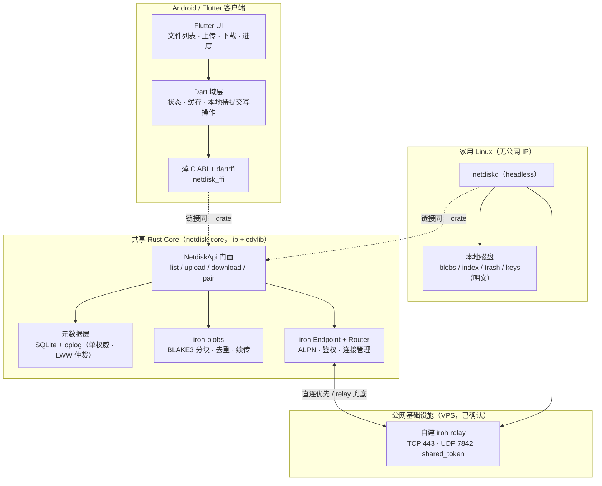

# 个人网盘（基于 iroh）架构设计

> 版本：v0.5 · 日期：2026-11-12 · 状态：**D1、D3、D4 已确认（含 D4 仲裁细则）**，其余决策待评审
> 变更：v0.5 锁定仲裁细则（到达顺序 / 直接丢弃不进回收站 / 组合场景默认），移除待确认措辞；v0.4 新增 §5.5 多端多写；v0.3 确认不做静态加密；v0.2 收敛 relay 方案；v0.1 为初稿
> 配套文档：[`DEVELOPMENT_PLAN.md`](./DEVELOPMENT_PLAN.md)

## 0. 本文的边界

本文回答「系统怎么切分、为什么这么切、哪里会出事」，不回答「某一行代码怎么写」。

文中把结论分成四类，便于审查：

- **【事实】** 2026-11-12 从上游仓库 / 官方文档查证到的内容，附来源。
- **【已确认】** 用户已拍板的决策，不再作为开放项讨论（目前为 D1、D3、D4 及 D4 仲裁细则）。
- **【判断】** 基于事实做出的设计选择，可被推翻。
- **【待验证】** 必须靠 PoC 实测才能定论，不允许在文档里假装已解决。

---

## 1. 需求与约束

| 项 | 内容 |
| --- | --- |
| 地基 | iroh（Rust P2P 连接层） |
| 服务端 | 家用 Linux 服务器，7×24 在线，**无公网 IP**（大概率处于运营商 CGNAT 之后） |
| 客户端 | Flutter，Android 优先，后续扩展 iOS / 桌面 |
| 网络目标 | 在家直连；出门在外（蜂窝 / 外部 Wi-Fi）也能读写 |
| 公网组件 | **【已确认】** 一台有公网 IP 的 VPS + 域名，跑自建 `iroh-relay` |
| 静态加密 | **【已确认】不做**（D3，见 §5.4）；防护改由访问控制承担 |
| 写入模型 | **【已确认】多端多写**（D4），仲裁细则已锁定，见 §5.5 |
| 数据 | 个人文件，含 GB 级大文件；默认规模 < 1 TB、文件数 < 10 万 |
| 用户 | 单用户、多设备；多个设备均可发起写操作 |

### 非目标（MVP 明确不做）

分享给他人、多人协作（不同用户）、在线预览/转码、无限版本历史、Web 端、CDN 加速、离线全文搜索、静态加密、被覆盖版本的找回。

### 术语澄清：什么是「多端多写」

- **端**：一个能独立运行客户端、持有自己的设备身份与本地缓存的实例（手机 / 平板 / 电脑）。家用服务器是**存储权威**，不算「写端」。
- **写**：任何会改变文件树的操作——上传、覆盖、删除、重命名、建目录、移动。单纯浏览 / 下载不算写。
- **单写者**：同一时刻只有一个端被授权发起写；不存在并发冲突。
- **多端多写（本项目采用）**：两个及以上端都能独立发起写，且可能离线各自修改后再同步，因此必须有冲突仲裁。
- **两个常见误解**：「服务端 7×24 在线」**不等于**多写；「多端只读」**不算**多写。

【已确认】D4 采用多端多写。注意这**不推翻单权威模型**：服务端仍是唯一的 revision 分配者与仲裁者，只是不再限制谁可以写。用单调递增 revision 做仲裁（§5.5），比引入 CRDT / 版本向量简单得多，也正好是弃用 `iroh-docs` 的理由之一。

---

## 2. 最重要的一个结论：无公网 IP ≠ 不需要公网组件

【事实】iroh 官方文档对入站要求的原文是：*"You do not have to open anything inward. There is no inbound rule to write, no port to forward, and no static IP to assign."*（<https://docs.iroh.computer/configuring-networks>）。设备确实不需要公网 IP、不需要端口映射。

但它同时说明，设备**至少**需要一条到 relay 的出站连接：relay 承担「引荐 + 打洞协调」，并在直连失败时转发流量。也就是说：

> iroh 消除的是「家里服务器必须被公网访问到」，**没有消除「必须存在一个双方都够得着的公网 relay」**。

这台 relay 不能放在无公网 IP 的家里。因此 relay 的落地方式是本项目第一个、也是影响最大的架构决策。

### 2.1 四种方案对比（D1 已收敛）

| 方案 | 做法 | 成本 | 优点 | 代价 / 风险 | 结论 |
| --- | --- | --- | --- | --- | --- |
| A. n0 免费公共 relay | 用默认 `presets::N0` | 0 | 零运维，`cargo add` 即用 | 官网明确标注 *rate limits*、*no uptime guarantee*；流量经第三方 | P0 PoC 参考 / 故障兜底条目 |
| **B. 廉价云 VPS 自建 relay** | 1C1G 小机型 + 域名 + Let's Encrypt，跑 `iroh-relay --features server` | 约 ¥20–60/月，**主要成本是流量费** | 完全可控；可配 `shared_token` 鉴权；可监控；数据不经第三方 | 需要一台公网机器和域名；转发双向计费，大文件流量翻倍 | **【已确认】选定方案** |
| C. 官方托管 relay | 购买 Iroh Services | $19/月起 + 超额流量 | 免运维 | 长期订阅成本；仍依赖第三方 | 备选，不采用 |
| D. 仅局域网 mDNS | 不做 relay，只在家用 | 0 | 零成本、零外部依赖 | 出门不可用，不满足核心诉求 | 仅作为「在家加速」补充 |

【已确认】采用 **B**，relay 配置与部署脚本纳入仓库 `infra/`。理由：relay 是**无状态转发器**，不解密、不落盘，放在 VPS 上的隐私代价很小；换来的是可控的可用性、鉴权和带宽策略。同时把 n0 公共 relay 配成 `RelayMap` 里的第二个条目做兜底，避免自建 relay 单点。

【事实】官网也把基础设施分成「免费公共 / 托管 / 自建」三档，并明确写着 *"Prefer to self-host? The relay software is free"*（<https://iroh.computer/>）。

### 2.2 流量成本必须提前算

【判断】CGNAT 之后的两端常常打不通洞（尤其两端都是对称 NAT），此时**全部文件流量都会经过 relay**。1 GB 文件上传在 relay 上产生约 2 GB 出站流量（收 + 发）。因此：

- VPS 选型按「流量包 / 带宽」而非 CPU 内存；
- 在家同一局域网启用 mDNS 直连，绕开 relay；
- 客户端默认「大文件仅在 Wi-Fi 下自动同步」，蜂窝网络手动触发；
- 服务端暴露 `direct_ratio`（直连流量占比）指标，作为长期观测项；
- relay 侧 `[limits.client.rx]` 设单客户端限速，避免单设备吃满带宽预算。

【待验证】真实运营商网络下的打洞成功率与稳态吞吐，列入 P0-1；实测数据用于最终确定 VPS 流量包规格。

### 2.3 relay 部署规格（D1 已确认，P0 前置）

**机器与网络**

- 【事实】relay 是无状态转发器；`iroh-relay/src/defaults.rs` 中默认 `DEFAULT_KEY_CACHE_CAPACITY = 1024 * 1024`，注释估算约 56 MB（64 位下按百万并发客户端设计）。因此 **1 vCPU / 1 GB 内存足够**，选型优先看流量包与带宽。
- 域名 A / AAAA 记录指向 VPS；`tls.hostname` 必须与客户端 `RelayUrl` 一致，例如 `https://relay.example.com`。
- VPS 入站放行：
  - TCP 80 — ACME HTTP-01 挑战 + captive portal；
  - TCP 443 — HTTPS 升级 WebSocket，**必须允许 Upgrade，不能只放行普通 HTTPS**；
  - UDP 7842 — QUIC 地址发现（相当于 STUN）；
  - TCP 9090 — metrics，**只绑 `127.0.0.1` / 内网，不对公网开放**。
- 家用服务器侧：**零入站规则**；出站需 TCP 443、UDP 7842，以及出站 UDP 任意端口（直连，强烈建议放行）。

**配置骨架**（字段名取自 `iroh-relay/src/main.rs` 的 `Config` / `TlsConfig` / `Limits` / `AccessConfig`）

```toml
http_bind_addr = "[::]:80"
enable_quic_addr_discovery = true
enable_metrics = true
metrics_bind_addr = "127.0.0.1:9090"
access.shared_token = ["<RELAY_TOKEN>"]

[tls]
hostname = "relay.example.com"
cert_mode = "LetsEncrypt"
contact = "ops@example.com"
prod_tls = true
https_bind_addr = "[::]:443"

[limits.client.rx]
bytes_per_second = 2_000_000
max_burst_bytes = 4_000_000
```

启动：`iroh-relay --config-path /etc/iroh/relay.toml`（二进制需 `--features server` 编译）。

**部署时必须核对的约束**

- `cert_mode` 大小写敏感：`Manual` / `LetsEncrypt` / `Reloading`；`LetsEncrypt` 要求 `hostname` 与 `contact` 都存在。
- **【事实 · 实机验证】内置 ACME 使用 TLS-ALPN-01（不是 HTTP-01），按规范必须独占 443 端口**。若 443 被 nginx 等现有 Web 服务占用，签发必然失败（实测 `tls: no application protocol`；连续失败 5 次还会触发 Let's Encrypt 429 失败授权限流）。此时改用 **certbot `--webroot` 走 nginx 80 做 HTTP-01 签发**，relay 设 `cert_mode = "Manual"` 读 `cert_dir/default.crt` + `default.key`（证书需复制并 chown 给非 root 的 relay 用户），再用 certbot 的 deploy hook 处理续期。本项目即采用该共存方案：RelayUrl 为 `https://relay.example.com:8443`，详见 `infra/README.md` §2.1。
- `enable_quic_addr_discovery = true` 必须同时配置 TLS，否则启动直接报错。
- `IROH_RELAY_ACCESS_TOKEN` 环境变量会用**单个 token 覆盖**配置文件里的整个 token 列表。
- `--dev` 只跑 `http://localhost:3340`、不启 QUIC 地址发现，且与 `LetsEncrypt` 冲突，**不能用于生产**。
- `Config::load()` 在配置文件路径不存在时会**静默回退默认配置**（plain HTTP :80、无 TLS、`access = "everyone"`）——部署后必须核对启动日志，不能只看「进程起来了」。
- 上游文档有出入：`docker/README.md` 写 `--config`（CLI 只有 `--config-path` / `-c`），Dockerfile 暴露 `3478/udp` 而源码默认 QUIC 端口是 **7842**；以源码 `defaults.rs` 为准。
- **【事实 · 实机验证】链路质量比部署参数更值得关注**：2026-11-12 在真实家用服务器（`192.168.1.8/24`、物理网卡 MTU 1450、零入站映射）上实测，到 VPS 8443 的新 TLS 连接约 60–90% 出现「TCP 已连、ClientHello 已发、收不到 ServerHello」；同一时刻 VPS 本机与手机 5G 客户端均 6/6 成功，故**不是 relay 服务端故障**；后续跨目标对照（境内 `mirrors.ustc.edu.cn` / `www.baidu.com` 与境外 `static.crates.io` / `www.cloudflare.com` 均 5/5，ICMP 0% 丢包）进一步证明**不是家宽国际出口、也不是「香港 VPS」这个地域的问题**，而是到 `203.0.113.10` 这条特定路径的间歇性丢包，且成功率随时间大幅波动（1/10 → 4/5 → 8/10）。PMTU 发现被 ICMP 过滤，对 8443 做 MSS clamp 实测无效，规则已撤销；突发与间隔连接无差异，排除限速。iroh 的 10s 拨号超时 + 自动重试最终能上线：`MODE=online` 5 次中 2 次 OK、`MODE=pair` 3 次中 1 次 echo PASS。**P3 前需在三条路里选一条**：① 换回程优化（移动 CMI / 电信 CN2 GIA / 联通 9929）的港服或已备案的大陆 VPS —— 优先前者，免备案且大流量包更适配 relay；② 让家用服务器走更稳的出口；③ 接受波动并加大重试与超时（`netdiskd` 不用 `online()` 当启动门槛）。换大陆 VPS 需先过备案（8443 也在检测范围）与固定小带宽两道门槛。已登记 **R14**，未拍板前不算已解决；详见 `tools/poc/p0-1/README.md` 的「补充对照与定性更正」。

**客户端 RelayMap 的一个坑**

自建 relay 需要 token，而 n0 公共兜底 relay **不接受这个 token**。因此 token 只能设置在自建 relay 对应的 `RelayConfig` 上（`RelayConfig::with_auth_token`），**不要用 `RelayMap::with_auth_token` 全局套到整张表**，否则兜底条目全部认证失败，且故障表现会是「间歇性、单向」的怪问题。P5 需专门验证「自建 relay 宕机 → 无 token 的兜底条目能接管」。

**双 relay 的取舍**

「自建为主 + n0 公共兜底」可用性更好，但故障时会把流量交给第三方（仍是端到端加密，元数据可见）。若要求流量绝不经过第三方，就改成「两台 VPS 各跑一个自建 relay」，代价是成本翻倍。当前默认保持前者；这一取舍可在 P5 复评，不阻塞 P0。

---

## 3. 总体架构



### 3.1 为什么必须有一个自建的 Rust Core crate

这是本项目第二个关键结论，来自一条容易被忽略的事实：

【事实】`iroh-ffi` 官方 README 原文：*"The bindings mirror the stabilized iroh 1.0 surface (endpoints, connections, paths, tickets, relays, services); higher-level protocols not yet at 1.0 (iroh-blobs, iroh-docs, iroh-gossip) are out of scope."*（<https://github.com/n0-computer/iroh-ffi>）。社区 `iroh_flutter` 插件的公开 API 也只覆盖连接层（endpoints / connections / streams / relays / address lookup，<https://pub.dev/packages/iroh_flutter>）。

也就是说：**现成的 FFI / Flutter 绑定都不含 blobs 与网盘语义**。无论选哪条 FFI 路径，文件传输、元数据、同步、鉴权、冲突仲裁这些逻辑都得写在自己的 Rust 层里，再由自己暴露给 Dart。

【判断】因此把 `netdisk-core` 做成 `lib + cdylib` 双产物：服务端 `netdiskd` 直接链接 `lib`，移动端链接 `cdylib`。**业务逻辑只写一份**，Dart 只负责 UI 和状态。

---

## 4. 版本现状与兼容矩阵

【事实】2026-11-12 查证结果：

| 组件 | 版本 | 状态 | 关键依赖 |
| --- | --- | --- | --- |
| `iroh` | 发布 `v1.4.1`（2026-10-21），`main` 为 `1.5.0` | 活跃，最近推送 2026-11-10 | — |
| `iroh-ffi` | `v1.2.0`（2026-10-22） | 活跃、未归档；官方支持 Python/Swift/Kotlin/Node.js，Dart/Flutter 为社区维护 | 镜像 iroh 1.0 表面 |
| `iroh_flutter` | `1.3.0`（2026-10-26），publisher `snowpine.io`（已验证） | 社区维护，覆盖 Android/iOS/macOS/Linux/Windows | cargokit + cargo-ndk |
| `iroh-blobs` | `0.104.1` | 活跃，最近推送 2026-11-11；**未到 1.0** | `iroh = "1.0.0"`、`iroh-base = "1.0.0"` |
| `iroh-docs` | `0.101.0` | 最近推送 2026-08-19（约 3 个月）；**未到 1.0** | `iroh = "1"`、`iroh-blobs = "0.103"`、`iroh-gossip = "0.101.0"` |

### 4.1 一个必须提前规避的依赖冲突

【事实】`iroh-docs 0.101.0` 声明 `iroh-blobs = "0.103"`，而 `iroh-blobs` main 已是 `0.104.1`。Cargo 对 `0.x` 的 caret 语义是 `>=0.103.0, <0.104.0`，与 `0.104.1` 不兼容。若同时直接依赖两者，`cargo` 会解析出**两份 blobs**，其类型（`Hash`、`Store` 等）互不相通，导致编译失败或更隐蔽的行为不一致。

【判断】MVP **不使用 `iroh-docs`**，只锁一个 `iroh-blobs` 版本，并把 `Cargo.lock` 入库。P0 用 `cargo tree -d` 验证无重复版本。

### 4.2 锁版本策略

- `iroh` 固定到已发布版本（起步 `1.4.1`），不追 `main`——上游 `Cargo.toml` 把 `noq` patch 到 git main，追 main 会引入不稳定依赖。
- `iroh-blobs` 固定到与所选 `iroh` 兼容的单一版本，升级时作为一次独立变更处理。
- 客户端链接的 `iroh` 版本必须与服务端、以及 VPS relay 的协议版本兼容；升级时三者一起验证，不做单边升级。
- 所有跨 crate 版本写入 `docs/COMPAT_MATRIX.md`，每次升级更新。

---

## 5. 数据层设计

### 5.1 内容：iroh-blobs

【事实】`iroh-blobs` 提供 BLAKE3 内容寻址、`bao-tree` 分块校验、范围请求、`fs-store`（redb + reflink）持久化与 `rpc` 传输 feature（见其 `Cargo.toml`）。

用于本项目：

- 文件按内容哈希寻址 → 天然去重（同内容只存一份）；
- 分块 + 校验 → 断点续传、传输损坏可检测；
- 范围请求 → 客户端按需拉取，不必整文件下载；
- `fs-store` 直接落在服务端磁盘。

### 5.2 元数据：自建 SQLite + oplog，而不是 iroh-docs

【判断】不采用 `iroh-docs` 承载文件树，理由有三：

1. 版本与活跃度风险（§4.1、§4 表格）：0.x、3 个月未推送、与 blobs 最新版冲突。
2. 模型不匹配：docs 是「多写者最终一致 KV」，而文件树需要路径索引、层级遍历、排序分页、按时间范围查询；KV 上做这些等于自己再造一层索引。
3. **服务端 7×24 在线，天然是唯一的仲裁点**。D4 虽允许多端多写，但不需要 CRDT：所有写请求都汇到服务端，由单调递增 `revision` 定序并按 §5.5 仲裁。这比维护版本向量 / 因果合并简单得多，冲突行为也更可预测。

建议 schema（简化）：

```
entries(
  id INTEGER PK,             -- 逻辑条目 id，冲突判定以它为准
  path TEXT UNIQUE,          -- 规范化后的完整路径
  parent_id INTEGER,
  kind TEXT,                 -- file | dir
  blob_hash BLOB NULL,       -- 指向 blobs
  size INTEGER,
  mtime INTEGER,             -- 客户端上报的展示用时间，不参与仲裁
  base_revision INTEGER,     -- 该条目最后一次被修改时的服务端 revision
  revision INTEGER,          -- 最后一次变更的 revision
  deleted INTEGER DEFAULT 0  -- 墓碑，回收站
)

oplog(
  revision INTEGER PK,       -- 单调递增，客户端按 since_revision 拉增量
  ts INTEGER,                -- 服务端时间，审计用
  device_id TEXT,
  op TEXT,                   -- upsert | delete | mkdir | rename | conflict_rename | discarded
  path TEXT,
  blob_hash BLOB NULL,
  base_revision INTEGER,     -- 写入时客户端看到的版本，用于 LWW 判定
  discarded_revision INTEGER -- 被丢弃的旧版本，仅审计，不保留内容
)

devices(id, name, pubkey, paired_at, revoked_at, can_write)
```

`can_write` 默认对所有已配对设备为 true；预留给将来的只读端。

同步协议（自定义 ALPN，例如 `netdisk/sync/1`）：

1. 客户端上报 `since_revision` 与本地待提交的写操作（携带 `base_revision`）；
2. 服务端按到达顺序为每条写操作分配新 `revision`，按 §5.5 仲裁；
3. 服务端返回增量 oplog（分页），客户端据此更新本地视图；
4. 客户端再按需通过 blobs 协议拉内容；
5. 上传先写 blobs（内容寻址、可续传），再提交一条 `upsert` 元数据；
6. 客户端离线期间可本地累积写操作，联网后按序提交；**「最新」由服务端到达顺序决定，不是设备上的操作时间**（§5.5.2）。

### 5.3 GC 与回收站

【待验证】`iroh-blobs` 的引用计数 / GC 语义需在 P2 实测确认。设计上不依赖它：由元数据层维护 `blob_hash` 引用集合，删除先进回收站（默认保留 30 天），GC 任务周期性计算「无引用且超过保留期」的 hash 再删除。

按 §5.5.4 的 LWW 规则，**被覆盖的旧版本直接丢弃**：不生成冲突副本、不进回收站、不提供任何找回路径；其 blob 在无其他引用后由 GC 回收，oplog 只留一条元数据审计记录。注意这与「用户删除文件 → 进回收站 30 天」是两条不同的路径，不要混淆。

### 5.4 静态数据：不做加密（D3 已确认）

【事实】iroh 保证的是**传输**端到端加密：relay 与链路上看不到明文。但服务端磁盘上的 blob、SQLite 索引以及备份文件**默认都是明文**，与传输加密无关。

【已确认】D3：MVP 及后续**不引入静态加密**——既不做 LUKS / 文件系统加密，也不做应用层每文件加密。收益是部署与备份简单、跨文件去重完整保留（§5.1）、无需额外密钥管理；代价由用户明确接受。

精确含义，避免后续误解：

- 服务端 `/var/lib/netdisk/` 下的 blob、索引、回收站，以及备份介质上的数据均为明文；
- **任何能读该目录的进程、或拿到硬盘 / 备份的人，都能直接读到文件内容**；
- VPS relay 不受影响——它本来就不落盘、不解密；
- 传输仍是端到端加密，公网链路上的保密性不变。

【判断】防护改由**访问控制**承担，而不是加密：

- `netdiskd` 以专用系统用户运行，数据目录 `0700`、文件 `0600`；
- systemd 沙箱（`ProtectSystem`、`ReadWritePaths` 限定可写路径、`NoNewPrivileges`）；
- 备份离线存放、权限受控、定期做恢复演练；
- 物理访问控制（家用机器 / 硬盘 / 备份盘）。

若将来改主意，**优先选 LUKS**（保留去重）；应用层每文件加密会破坏内容寻址去重，必须同时改 §5.1 的去重策略。这属于独立变更，不塞进 MVP。对应风险登记为 R11。

### 5.5 冲突仲裁策略（D4 已确认，细则已锁定）

【已确认】用户给出的三条规则，以及随后确认的仲裁细则：

1. 相同文件 → 直接覆盖；
2. 不同文件但文件名相同 → 自动重命名；
3. 多端同时写一个文件 → 保留最新修改，丢弃旧的；
4. 「最新」= 服务端到达顺序；
5. 丢弃 = 直接丢弃，**不放回收站**；
6. 未覆盖的组合场景按 §5.5.5 的默认表执行。

本节不再含待确认项。

#### 5.5.1 判定优先级：先区分「同一条目」与「新建撞名」

规则 2 与规则 3 在「两端各自新建同名文件」这一场景下会给出相反结果：规则 2 要保留两份，规则 3 要丢一份。因此必须先判定写入是否指向**同一个已存在的逻辑条目**（`entries.id`），而不是只看路径字符串：

| 情况 | 判定 | 处理 |
| --- | --- | --- |
| 两端修改**同一个已存在条目**（携带相同或相近 `base_revision`） | 规则 3 | **LWW**：服务端 `revision` 大者生效，旧版本直接丢弃 |
| 两端各自**新建**、路径撞名，**内容 hash 相同** | 规则 1 | 幂等覆盖：不产生第二个条目、不产生第二份 blob（§5.1 去重天然处理） |
| 两端各自**新建**、路径撞名，**内容 hash 不同** | 规则 2 | 后来者自动重命名，两份都保留 |
| 单端上传，目标路径已存在且内容 hash 相同 | 规则 1 | 直接覆盖（实为幂等，只更新元数据） |

【已确认】这张判定表是对三条规则的边界解释，已确认按此实现。

#### 5.5.2 「最新」= 服务端到达顺序（已确认）

【已确认】**不采用客户端 `mtime` 或本地时钟判定新旧**，唯一依据是服务端**单调递增 `revision`，即写入到达服务端的先后顺序**：谁最后被服务端接受，谁就是「最新」。这与 §5.2 的单权威模型天然一致，不需要向量时钟或 CRDT。`mtime` 只作为展示字段保留，不参与仲裁。

不用客户端时钟的理由：设备时钟会漂移、可被手动修改、离线写入的时间不可比。

明确后果（用户已接受）：**离线设备上更早做的一次修改，如果更晚才同步到服务端，反而会覆盖掉后来已同步的修改**。这是 LWW 的固有语义。客户端 UI 仍在检测到覆盖时给一条提示，避免完全无感，但不提供撤销或找回。

#### 5.5.3 重命名规则

【判断】后来者按 `原名 (2).扩展名`、`原名 (3).扩展名` 递增命名，序号取当前同名冲突计数 + 1；目录同名同样处理。重命名结果作为一条 `op = conflict_rename` 写入 oplog 并广播给所有端，保证各端最终看到相同的名字。命名必须幂等：同一写请求重放不得产生第三个副本（用请求 id / `(device_id, base_revision)` 去重）。

#### 5.5.4 丢弃：直接丢弃，不进回收站（已确认）

【已确认】旧版本**直接丢弃**：不生成冲突副本、**不进回收站**、不提供任何找回路径，也不保留旧内容。其 blob 在无其他引用后由 GC 回收。用户已明确确认无需回收站兜底。

【判断】oplog 仍保留一条 `discarded` 审计记录（`revision`、`device_id`、旧 `blob_hash`、被谁覆盖、`base_revision`），**只记元数据、不留内容**。它用于事后追溯「文件什么时候被谁盖掉了」，不构成恢复手段，也不改变「直接丢弃」的语义。

#### 5.5.5 组合场景默认（已确认）

【已确认】用户已确认按下列默认实现；这些默认都不引入 CRDT，仍在服务端单权威内完成。

| 组合 | 行为 | 理由 |
| --- | --- | --- |
| A 删除文件，B 同时修改它 | 按 revision 顺序应用：若删除在后 → 文件进回收站（不从磁盘立刻抹掉，30 天内可恢复）；若修改在后 → 视为对墓碑的写入，按自动重命名生成新文件 | 避免静默丢失 B 的修改 |
| A 重命名，B 修改原路径 | 重命名先应用；B 的写入按「目标路径无条目」处理，走 §5.5.1 的新建分支（可能自动重命名） | 保持两条操作都不丢 |
| 目录被移动，其内部有并发写 | 子条目继承新的 `parent_id`；路径冲突按同一套规则递归处理 | — |
| 同名目录 vs 同名文件 | 视为不同类型，自动重命名后来者 | 避免类型覆盖 |

> 注意：「删除 vs 修改」中**删除产生的回收站**是普通用户删除行为（§5.3），与 §5.5.4「被 LWW 覆盖的旧版不进回收站」并不矛盾。

---

## 6. 连接与身份

### 6.1 地址发现：刻意简化

【事实】默认预设会向 `dns.iroh.link` 发布 / 查询地址（DNS TXT），官方文档把它列为必需出站项之一，并说明可以换成自建 `iroh-dns-server` 或干脆关掉地址发现（<https://docs.iroh.computer/configuring-networks>）。

【判断】本项目是**单用户 + 固定服务端**，不需要通用发现服务。做法：

- 服务端与客户端都用 `presets::Empty`，显式配置 `RelayMode::Custom(RelayMap)`（自建 relay 为主、n0 公共为兜底，token 隔离见 §2.3）；
- 首次配对把服务端的 `EndpointAddr`（`EndpointId` + relay URL + 直连地址）写入 ticket，客户端持久化，之后直接 dial；
- 同局域网时另启用 mDNS 地址发现，优先走本地直连。

收益：完全去掉对 `dns.iroh.link` 的依赖，也去掉一类「DNS 过滤 stripping TXT 记录」的现场故障。

### 6.2 配对与鉴权分层

三层不要混为一谈：

| 层 | 机制 | 防什么 |
| --- | --- | --- |
| 传输层 | iroh 基于 EndpointId 的 QUIC 认证加密 | 中间人、窃听 |
| relay 层 | `access.shared_token`（或 `allowlist`） | 陌生设备蹭你的 relay 带宽 |
| **应用层** | 配对后 ALPN 握手内的 challenge-response + 设备白名单 | **未授权设备连上服务端后读写文件** |

【判断】relay 的 token 不等于应用鉴权——relay 只转发，不认识你的业务。必须在 `netdisk/sync/1` 协议内自己做一次设备授权，并在服务端维护可撤销的 `devices` 表。D4 下**所有已配对设备默认可写**，`can_write = false` 仅用于可选的只读端；未配对设备一律拒绝写入。

### 6.3 密钥管理

- EndpointId 私钥即设备身份，丢失 = 换身份，需重新配对。
- Android：Keystore / StrongBox 保存，尽量不落普通文件；应用卸载即失效，需考虑备份/恢复路径。
- 服务端：`/var/lib/netdisk/keys/`，`0600`，专用户运行；随备份**单独离线保存、权限受控**（按 D3 不额外加密，见 §5.4）。
- relay token：只保存在 VPS 的 `/etc/iroh/relay.toml`（`0600`）与客户端配置中，不进代码仓库；建立轮换流程（改配置 → 重启 → 更新所有客户端）。
- 配对 ticket：二维码或短字符串，含 EndpointId + relay URL + 一次性配对码，**不包含长期私钥**；配对码一次性、有有效期。

---

## 7. Flutter / Rust 边界

### 7.1 路径选择

| 路径 | 说明 | 结论 |
| --- | --- | --- |
| 直接用 `iroh_flutter` | 现成 Dart API、cargokit 构建、Android JNI 初始化都做好了 | **仅用于 P0 连通性 PoC**；它不暴露 blobs / 网盘语义，无法支撑产品代码 |
| 自建 `cdylib` + `dart:ffi`（ffigen） | 自己定义 `NetdiskApi` 的 C ABI，业务 API 一次暴露 | **推荐**。可复用 `iroh_flutter` 的 cargokit / cargo-ndk 构建管线与 Android Context 初始化做法 |
| 官方 `iroh-ffi` / uniffi → Kotlin → Flutter Plugin | 官方维护、类型安全 | 多一层 Kotlin↔Dart 转换，且同样不含上层协议，收益不足 |

【事实】`iroh_flutter` 的 Android 说明值得直接借鉴：cargokit 通过 cargo-ndk 交叉编译 cdylib 进 `jniLibs`；`minSdk 24`；**NDK r28+ 以满足 Google Play 16 KB 页对齐**；插件在引擎启动时把 JavaVM + Context 注入 native 库，iroh 需要它做系统 DNS、网卡枚举和 TLS 信任（<https://pub.dev/packages/iroh_flutter>）。1.0.2 的 changelog 正是修「release build 未初始化 Android context 导致 `Endpoint.bind` 崩溃」——自建方案必须复现这个初始化步骤。

### 7.2 FFI 契约原则

- **薄**：只暴露 `NetdiskApi` 门面，绝不让 `Endpoint`、`Hash`、`Store` 等 Rust 类型泄漏到边界。
- **同步 + 事件**：C ABI 全是同步函数返回 `op_id`；长任务在内部 tokio runtime 执行，进度 / 完成 / 错误通过回调或事件队列推送。**不要把 Future 跨 FFI**。
- **数据格式**：请求 / 响应用 JSON 或 postcard + 长度前缀 buffer，由 `netdisk_ffi` 负责分配 / 释放，配套 `nd_free()`。
- **大文件走文件句柄，不走 buffer**：Dart 传 `content://` URI 或路径，Rust 侧自己打开流式读写，避免把 GB 级数据复制进 Dart 堆导致 OOM。
- **relay 配置由 Dart 传入**：`nd_init(config_json)` 里包含 relay URL 与 token，便于 token 轮换时不用改 Rust 代码。
- **写请求携带 `base_revision`**：跨 FFI 的写入参数必须带上客户端所见版本与请求 id，服务端据此做 LWW 判定与幂等去重（§5.5）。

示意接口（非最终签名）：

```
nd_init(config_json) -> handle
nd_pair(handle, ticket_json) -> result_json
nd_start(handle, event_cb) -> status
nd_list(handle, path, since_revision) -> result_json
nd_upload(handle, path, src_uri, base_revision) -> op_id
nd_download(handle, entry_id, dst_uri) -> op_id
nd_cancel(handle, op_id) -> status
nd_poll_event(handle) -> event_json | null
nd_free(ptr)
```

### 7.3 Android 侧注意事项

- 前台服务（Foreground Service）承载长连接与同步任务；Doze / 厂商省电策略需引导用户加白名单，并用 WorkManager 做补偿同步。
- 权限：读取媒体/文件、通知（Android 13+）、前台服务；尽量走 SAF / `content://`，避免依赖宽泛存储权限。
- 网络切换由 QUIC 连接迁移自身处理，但应用层仍需处理「任务中断 → 按 hash 续传」。
- 离线写入先落本地待提交队列；检测到自己的写被覆盖时给一条 UI 提示（§5.5.2），**不提供撤销 / 找回入口**。
- 优先 `arm64-v8a`；注意 NDK r28+ 与 16 KB 页对齐要求；关注 so 体积（Rust + iroh + blobs 静态链接会明显增大包体）。

---

## 8. 服务端部署

- `netdiskd`：headless Rust daemon，链接同一个 `netdisk-core`；systemd 托管，崩溃自动重启；**专用户 + 目录 0700 / 文件 0600 + 沙箱**（D3 下这是主要防护手段）。
- 目录：`/var/lib/netdisk/{blobs,index,trash,keys,versions}` + `/etc/netdisk/config.toml`。
- **入站**：无需任何端口映射 / 静态 IP；出站需 TCP 443（relay，且必须允许 WebSocket Upgrade）、UDP 7842（QUIC 地址发现）、出站 UDP 任意端口（直连，强烈建议放行）。
- relay 侧（VPS）：按 **§2.3 的部署规格**执行，`iroh-relay --config-path /etc/iroh/relay.toml`。两条易踩的坑：配置文件路径写错会静默回退默认；上游 docker 文档的参数名 / 端口与源码不一致，以源码为准。
- 备份：`index` SQLite + `blobs` 目录 + 密钥，单独离线保存且权限受控（**明文，见 §5.4**）；定期做一次恢复演练，而不是只做备份。
- 观测：`direct_ratio`、`relay_bytes_total`、`oplog_revision`、同步失败数、**冲突/丢弃计数**、磁盘水位；relay 的 metrics 只在本机 / 内网可访问。

---

## 9. 安全边界（威胁模型）

| 威胁 | 现状 | 缓解 |
| --- | --- | --- |
| relay 运维读取文件内容 | iroh 传输端到端加密，relay 不解密 | 成立；但仍可见 EndpointId、IP、时序、流量大小等元数据 |
| VPS 被入侵 | 只有无状态转发，无用户数据 | 最小权限、只开 80/443/UDP 7842、metrics 不公网暴露、token 定期轮换 |
| 自家硬盘 / 备份被物理拿走 | **blob 与索引明文落盘（D3 已确认，属已接受风险）** | 不做加密；靠专用户 + 0700/0600 + 物理访问控制 + 备份离线受控（§5.4） |
| 服务端进程被入侵读取明文 | 同上，无静态加密兜底 | systemd 沙箱、`ReadWritePaths` 限定可写路径、`NoNewPrivileges`、最小权限 |
| 陌生设备蹭 relay | 默认 `everyone` | `shared_token` / `allowlist`（§2.3） |
| 陌生设备直连服务端 | relay 层鉴权管不到 | 应用层设备白名单 + challenge-response（§6.2） |
| 中间人 / 重放 | QUIC 认证加密 + 一次性配对码 | 配对码设短 TTL、一次性；写请求按 `(device_id, base_revision)` 幂等去重（§5.5.3） |
| 服务端单点丢数据 | 只有一份 | 备份 + 恢复演练 + 回收站（仅用户删除路径；LWW 覆盖不保留） |

---

## 10. 风险登记册

| # | 风险 | 影响 | 缓解 | 验证阶段 |
| --- | --- | --- | --- | --- |
| R1 | 现成 Flutter/FFI 绑定只覆盖核心层 | 必须自建 FFI，工作量被低估 | 自建 `netdisk-core cdylib`；复用 `iroh_flutter` 构建管线 | P0 |
| R2 | blobs / docs 0.x 版本不兼容 | 双版本、类型不通 | MVP 弃用 docs，锁单一 blobs 版本，`Cargo.lock` 入库 | P0 |
| R3 | CGNAT 打洞失败 → 流量长期走 relay | 带宽成本、速率上限 | mDNS 直连、Wi-Fi 策略、`[limits.client.rx]`、`direct_ratio` 监控 | P0 |
| R4 | 自建 relay 单点 | 宕机时新连接/重连/地址发布全停 | `RelayMap` 配自建 + n0 公共兜底；**token 只绑自建条目**（§2.3） | P1 / P5 |
| R5 | 大文件跨 FFI 复制导致 OOM | 崩溃 | 传 URI / 文件句柄，Rust 侧流式处理 | P1 |
| R6 | Android 后台被杀 | 同步中断 | 前台服务 + WorkManager 补同步 + 断点续传 | P2 |
| R7 | GC 误删 / 存储膨胀 | 丢数据或磁盘打满 | 元数据层自己管引用集合，回收站缓冲 | P2 |
| **R8** | **LWW 静默丢弃旧修改（D4 已接受）** | 被覆盖的版本**不可恢复**；离线较晚同步的旧修改可能盖掉较新的 | 接受不可恢复；oplog 留 `discarded` 审计记录、客户端覆盖提示、冲突/丢弃计数监控，**不提供找回路径** | P2 / P5 |
| R9 | 上游 0.x 协议 breaking change | 升级成本 | 锁版本、隔离在 core 层、客户端/服务端/relay 三者一起验证 | 持续 |
| R10 | VPS 流量超预算 / 被限速 | 同步变慢或产生额外账单 | 流量告警、单客户端限速、大文件 Wi-Fi 策略 | P0-pre 起持续 |
| R11 | 磁盘 / 备份明文落盘（D3 已接受） | 物理窃盘或本机进程入侵即泄露全部文件 | 专用户 + 0700/0600、systemd 沙箱、备份离线受控、物理访问控制；将来可加 LUKS | P3 |
| R12 | 自动重命名产生「副本泛滥」 | 反复撞名时目录里堆积 `x (2) (3)...` | 命名幂等（请求 id 去重）、冲突计数上限告警、UI 提供批量清理入口 | P2 / P4 |
| **R13** | **内置 ACME 用 TLS-ALPN-01，必须独占 443** | 443 被现有 Web 服务占用时证书签发失败，连续失败还会触发 Let's Encrypt 429 限流 | 改用 certbot HTTP-01 + `cert_mode = Manual` + 续期 hook（§2.3、`infra/README.md` §2.1） | P0-pre（实机已解决） |
| **R14** | **移动家宽 → CMI 国际出口 → 港服的跨境段丢包（实机定位）** | 端到端 ICMP 小包 6.67% / 大包 13.33% 丢包；TLS 握手到 VPS 7/12，成功也要 1.6–5.5s，对照 `static.crates.io` 12/12；iroh 的 10s 拨号预算易被 TCP 重传耗光 | `mtr -T -P 8443` 把丢包定位在 `211.136/221.183` 移动骨干与 `223.120` CMI 国际出口；家宽整体与 VPS 机房均正常。**换大陆 VPS 改善最确定**（消掉跨境段），但需过备案（8443 在检测范围）+ 固定带宽与 relay 流量放大冲突；当前已在 CMI 路径上，换同线路港服改善不确定。零成本优先做「5G 出口对照」。`netdiskd` 不用 `online()` 当启动门槛。MSS clamp / 突发限速已排除，勿重复 | P0-pre 发现 / P3 处置 |
| **R15** | **家用服务器本机环境干扰** | `.bashrc` 的 `HTTP_PROXY/ALL_PROXY` 指向未运行的 7897，会拖垮任何读代理的出站请求；14 个 UP 接口（Docker 网桥 + 多 VPN）可能让 iroh 枚举出大量无效直连地址 | `netdiskd.service` 显式 `UnsetEnvironment=` 代理变量并设 `NO_PROXY=*`；P3 评估地址候选过滤 | P3 |

### R14 更新（2026-11-13）：默认改用 n0 官方公共 relay，绕过该路径

实测对照（家用服务器 → 各 relay，TLS 握手各 8 次）：

| Relay | 成功率 | 耗时 |
| --- | --- | --- |
| **n0 `aps1-1`（亚太）** | **8/8** | 1.29–1.43 s |
| n0 `euc1-1`（欧洲） | 8/8 | 1.76–3.01 s |
| n0 `use1-1`（美东） | 8/8 | 1.80–2.83 s |
| n0 `usw1-1`（美西） | 8/8 | 1.76–4.32 s |
| 自建港服 `:8443` | **2/8** | 失败均为 6 s 超时 |

结论：R14 是**到 `203.0.113.10` 这条特定路径**的问题，不是「香港地域不行」也不是「家宽国际出口不行」——n0 官方 relay 走的是完全不同的网络，四个节点全部 8/8。

处置：`NETDISK_RELAY_URL=n0` 成为默认值，等价于 iroh `presets::N0`：

- 官方四节点 relay，`net_report` 自动择优（实测选中 `aps1-1`）；
- 启用 `dns.iroh.link` 地址发现，客户端只需 `EndpointId` 就能解析出完整地址（`{"id":"...","addrs":[]}`），服务端换 relay 也不用重新分发配对信息；
- 不需要 token（公共 relay 免费、有速率限制，无 SLA）。

实测闭环：本机 CLI（n0 + 只给 EndpointId）24 秒内完成 `ping / list / put / get`，1 MB 文件 sha256 一致；Flutter worker 路径 `list` **一次成功 2.1 s**（对比自建 relay 下 3 次重试仍超时）。

自建 relay 保留为可选（`NETDISK_RELAY_URL=https://relay.example.com:8443` + token），用于将来需要自主可控 / 隐私边界的场景。**R14 本身没有消失**，只是不再挡在默认路径上；若改用自建仍需先解决线路问题。

#### 2026-11-13 补充：公网打洞实测成功，relay 只承担引荐

在 Windows 客户端关闭 Tailscale 后（排除虚拟网卡干扰），用 `netdisk-cli ping` 观察 `Connection::paths()`：

```
path    : relay * https://euc1-1.relay.n0.iroh.link./ rtt=395ms
path+4s : relay   https://euc1-1.relay.n0.iroh.link./ rtt=350ms | direct* 198.51.100.20:52849 rtt=7ms
```

`198.51.100.20` 是家用服务器的公网 NAT 映射（QUIC 地址发现得到），**打洞成功并切到直连**。含义：

- 应用数据不再经过 relay，**n0 公共 relay 的速率限制不影响传输**，只影响建立连接时的几百毫秒；
- `net_report` 会自动择优：同一台机器先后选中过 `aps1-1`（RTT 800–1000 ms）和 `euc1-1`（RTT 350 ms），说明**亚太节点对国内反而不稳**，不能假设「地理近=更快」。

**两个保留**：① 7 ms 偏低，说明两端很可能同运营商/同区域（或 NAT hairpin），跨省跨运营商时 RTT 会高，但「能否打通」取决于 NAT 类型而非距离；② 手机 5G 是另一套 NAT，需单独验证。

#### 2026-11-13 补充二：手机上通过 IPv6 直连成功（`direct=YES`）

手机（Flutter App）点「刷新列表」时，服务端 `netdiskd` 记录的路径：

```
inbound connection, paths: relay * https://aps1-1.relay.n0.iroh.link./ rtt=1114ms
paths +4s            : relay   https://aps1-1.relay.n0.iroh.link./ rtt=1274ms
                     | direct* [2001:db8:1::2]:42354 rtt=32ms | direct=YES
```

`240e::/20` 是电信 IPv6 段，服务端是 `2409::/20`（移动 IPv6）。**双方通过公网 IPv6 直接连通，RTT 32 ms，完全绕过 relay。**

这意味着：手机端的数据面也不经过 relay，n0 的速率限制与 800–1200 ms 的中继 RTT 只影响「建立连接」这一小段。三条路径的最终结论：

| 客户端环境 | 实际路径 | RTT |
| --- | --- | --- |
| Windows 桌面（有 Tailscale） | Tailscale 虚拟网卡直连 | 5–6 ms |
| Windows 桌面（无 VPN，IPv4） | 公网 IPv4 NAT 打洞（`198.51.100.20`） | 7 ms |
| Android 手机（IPv6 可用） | **公网 IPv6 直连（`240e::`）** | **32 ms** |
| 无 IPv6 且打洞失败 | relay 兜底 | 800–1300 ms |

**需要注意的边界**：手机这条是 **IPv6** 直连。如果客户端网络只有 IPv4（部分公共 WiFi、老旧固网、某些企业网），IPv6 路径不存在，就要靠 IPv4 打洞，失败时才回落 relay。也就是说「能直连」不是无条件保证，而是「有 IPv6 就几乎必成，只有 IPv4 时看 NAT 类型」。

**测试方法教训（重要）**：`accept()` 里打的 `paths()` 是**连接建立瞬间的快照**，那时通常只有 relay 路径；打洞要 1–4 秒。服务端必须在延迟后再打一次（`netdiskd` 现在会在 +4 s 打第二次并输出 `direct=YES/NO`），否则会误判成「只走 relay」。

**教训（测试方法）**：这台开发机同时挂着 Tailscale / ZeroTier / WireGuard / 5 个 Docker 网桥，iroh 会优先选中这些**虚拟网卡直连**，得出的 RTT 极低（5–11 ms）却**不代表公网打洞成功**。判断依据必须是 `remote_addr` 是不是公网 IP —— 看 `100.64/10`（Tailscale）、`10.x`、`172.16–31.x`（Docker）就要意识到测试被污染了。

---

## 11. 决策点状态

| # | 决策 | 状态 / 取值 | 影响面 |
| --- | --- | --- | --- |
| **D1** | relay 形态 | **✅ 已确认：默认 n0 官方公共 relay**（`NETDISK_RELAY_URL=n0`）；自建 VPS relay 已完成并保留为可选（§2.3、风险 R14 更新） | 成本、隐私、可用性、整体网络拓扑 |
| D2 | 是否必须外网可访问 | 默认「是」 | 决定是否必须有公网 relay |
| **D3** | 静态加密 | **✅ 已确认：不做**（§5.4）；防护改由访问控制承担 | 部署简化、去重完整保留、明文落盘风险（R11） |
| **D4** | MVP 是否多端多写 | **✅ 已确认：多端多写 + LWW / 同名自动重命名**；细则已锁定：最新 = 到达顺序、旧版直接丢弃不进回收站、组合场景按 §5.5.5 | 元数据层、离线写队列、冲突仲裁、UI 提示（R8、R12） |
| D5 | 规模上限 | 默认「< 1 TB / < 10 万文件」 | SQLite / redb 选型、GC 频率 |
| D6 | 版本历史与回收站 | 默认「回收站 30 天，不做无限版本」 | 存储放大、GC 策略；注意 LWW 覆盖的旧版**不进**回收站 |
| D7 | 是否接受社区维护的 `iroh_flutter` 作为构建依赖 | 默认「只借鉴、不直接依赖」 | 长期维护风险 |

D2、D5–D7 仍按默认值推进，不阻塞 P0；§5.5 仲裁细则已全部确认，不再作为开放项。

---

## 12. 主要来源

- iroh 仓库与 README：<https://github.com/n0-computer/iroh>
- 官方网络部署文档：<https://docs.iroh.computer/configuring-networks>
- 官网基础设施三档：<https://iroh.computer/>
- `iroh-ffi`（支持矩阵与范围说明）：<https://github.com/n0-computer/iroh-ffi>
- `iroh_flutter` / `iroh_quic`：<https://pub.dev/packages/iroh_flutter>
- `iroh-blobs`：<https://github.com/n0-computer/iroh-blobs>
- `iroh-docs`：<https://github.com/n0-computer/iroh-docs>
- `iroh-relay` README（部署与访问控制）：<https://github.com/n0-computer/iroh/tree/main/iroh-relay>
- 本仓库 `iroh-relay/src/defaults.rs`、`iroh-relay/src/main.rs`（端口、配置字段、默认值）
